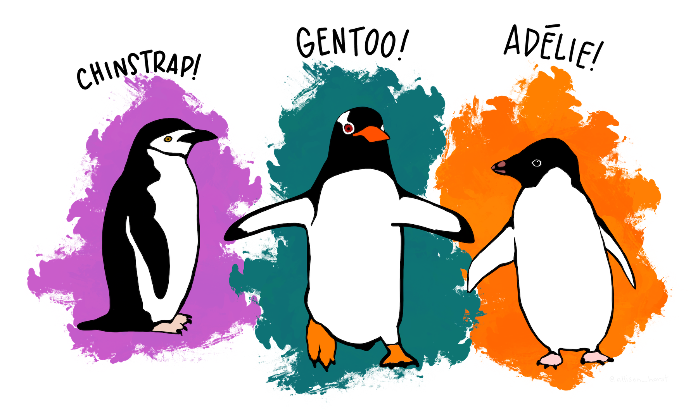

```{r}
library(ggplot2)
```

## Meet Quarto

Quarto enables you to weave together content and executable code into a finished document. To learn more about Quarto, see <https://quarto.org>.

## Meet the penguins

The `penguins` data from the [palmerpenguins](https://allisonhorst.github.io/palmerpenguins/) package contains size measurements for 344 penguins from three species observed on three islands in the Palmer Archipelago, Antarctica [@horstJournalPalmerArchipelago2022].



@gormanEcologicalSexualDimorphism2014 examined ecological differences between male and female Antarctic penguins.

## Results

```{r}
penguins <- read.csv("../data/data.csv")
```

Adding 25 and 25 gives `r 25 + 25`.

```{r}
source("../scripts/do_addition.R")
do_addition(25, 25)
```

The dataset contains `r sum(penguins$Species == "Gentoo penguin (Pygoscelis papua)", na.rm = TRUE)` Gentoo penguins and `r sum(penguins$Species == "Chinstrap penguin (Pygoscelis antarctica)", na.rm = TRUE)` Chinstrap penguins.

The dataset contains `r sum(penguins$Species == "Adelie Penguin (Pygoscelis adeliae)", na.rm = TRUE)` Adélie penguins.

```{r}
#| echo: false
ggplot(penguins, aes(x = `Flipper.Length..mm.`, y = `Culmen.Length..mm.`)) +
  geom_point(aes(color = Species, shape = Species)) +
  scale_color_manual(values = c("darkorange", "purple", "cyan4")) +
  labs(
    title = "Flipper and Culmen length",
    subtitle = "Dimensions for penguins at Palmer Station LTER",
    x = "Flipper length (mm)",
    y = "Culmen length (mm)",
    color = "Penguin species",
    shape = "Penguin species"
  ) +
  theme_minimal()
```
